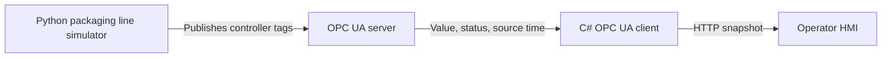

# Packaging Line HMI and OPC UA Diagnostics

An AI-assisted portfolio project for practicing C# HMI development and OPC UA troubleshooting on a simulated nonwovens packaging station. The Python simulator publishes four tags over OPC UA. The read-only HMI shows line state, pack count, throughput, and tag diagnostics so an operator can distinguish a machine stoppage from an unreliable sensor reading.



## Run the demo

Install Python 3.10+ and the [.NET 10 SDK](https://dotnet.microsoft.com/en-us/download/dotnet/10.0). Open both terminals in the project folder. In the first terminal on macOS or Linux, run:

```sh
python3 -m venv .venv
.venv/bin/python -m pip install -r requirements.txt
.venv/bin/python simulator.py
```

On Windows, run `py -m venv .venv`, then use `.venv\Scripts\python.exe` in place of `.venv/bin/python` for the next two commands. In the second terminal, run:

```sh
dotnet run
```

Open [the HMI](http://127.0.0.1:5070/). The simulator cycles through normal running, jam, recovery, and sensor failure. To hold a scenario, restart the simulator with `--scenario normal`, `--scenario jam`, or `--scenario sensor`. Both services listen on loopback. The OPC UA training endpoint uses `SecurityPolicy None` inside this local lab.

| Demo case | What the operator should see |
| --- | --- |
| Normal run | Speed around 60 packs/min, count increases, and all tag statuses are `Good`. |
| Discharge jam | `JamDetected` is true, speed is a valid `0`, and the pack count stops increasing. |
| Speed sensor failure | Conveyor still runs, but speed is hidden and the trend has a gap. Its OPC status is `BadSensorFailure`. |
| Connection loss | Stop the simulator. The HMI shows `Offline` and clears tag values. Restart the simulator to see it reconnect automatically. |

## What to explain in the interview

> I simulated a nonwovens packaging station and built a C# HMI that reads its data over OPC UA. I used four tags: conveyor running, line speed, pack count, and jam detected. The important case is the difference between a valid zero and a value I can't trust. In a jam the line is stopped and zero speed has good quality. If the speed sensor fails, the line can still be running, but I hide the speed and show its OPC status. If the server goes offline, the HMI reports a communication failure and retries.

| Topic | How it fits |
| --- | --- |
| HMI and C# | `LineMonitor.cs` opens an OPC UA session and polls once per second. It interprets status and freshness, then supplies a JSON snapshot to the operator screen. |
| OPC UA | A tag is a variable node identified by a NodeId. For each tag the client reads a value, a `StatusCode`, and a source timestamp. In this simulator a good value with a source time older than four seconds is treated as stale. |
| OPC DA | Classic Data Access uses COM/DCOM and exposes value, quality, and timestamp. A DA client browses item IDs rather than UA NodeIds. |
| MatrikonOPC | The Simulation Server supplies sample OPC DA items. MatrikonOPC Explorer is a DA client that verifies the source values and quality. |
| Kepware / KEPServerEX | In the Windows lab, Kepware reads the Matrikon DA items with its optional DA Client driver and publishes the mapped tags to an OPC UA client. |
| DCS | A DCS distributes control among controllers and provides supervisory monitoring. The demo illustrates the controller-to-operator data path. The simulator models one station and contains the jam response. |
| FactoryTalk Optix | The JD names Optix and View. In Optix, an equivalent exercise uses an OPC UA client, imported tags bound to display widgets, and C# NetLogic where custom behavior is needed. |

When troubleshooting, check whether the client can reach the server. Then verify the tag address, the status and timestamp, and finally the process value. This tells you which layer to investigate before changing any configuration.

## Windows lab for Kepware and MatrikonOPC

The runnable Mac demo uses the Python OPC UA server and the C# HMI. This separate exercise requires a Windows machine or VM and access to Kepware's OPC DA Client driver. It uses sample Matrikon items, so record the actual names you select. The vendor integration is documented for practice and has not been executed in the Mac demo.

1. Install MatrikonOPC Simulation Server and MatrikonOPC Explorer on the same Windows machine. In Explorer, connect to the simulator and add one changing numeric item. Record its item ID, value, quality, and timestamp.
2. In Kepware, create an OPC DA Client channel and a device that points to that same local server. Import the item and verify it changes in Kepware's OPC Quick Client.
3. Configure a Kepware OPC UA endpoint. In a UA client such as FactoryTalk Optix, connect using the endpoint's matching security settings, establish certificate trust as applicable, and browse to the imported tag. Record its UA NodeId, value, status, and source timestamp if provided.
4. Compare readings from Explorer and the UA client over several updates. Stop the Matrikon source briefly and record what the UA client reports. Restore it and verify recovery. Record differences in timestamps or scan intervals rather than assuming the readings are simultaneous.

References: [OPC Classic](https://opcfoundation.org/about/opc-technologies/opc-classic/), [OPC UA data item attributes](https://reference.opcfoundation.org/specs/OPC-10000-8/5.5), [Matrikon simulation server](https://www.matrikonopc.com/products/opc-drivers/opc-simulation-server.aspx), [Matrikon OPC Explorer](https://www.matrikonopc.com/products/opc-desktop-tools/opc-explorer.aspx), [Kepware UA setup and DA driver](https://support.ptc.com/help/kepware/features/en/kepware/features/OPCUACONFIGMNGR/quick-start-tutorial.html), and [Rockwell NetLogic](https://www.rockwellautomation.com/en-mde/docs/factorytalk-optix/current/installation-guide-ditamap/netlogic.html).

## Resume bullet

> Built a C# HMI for a simulated nonwovens packaging line, integrating live OPC UA tags to visualize throughput and pack count and distinguish conveyor jams, bad sensor data, and communication loss.
